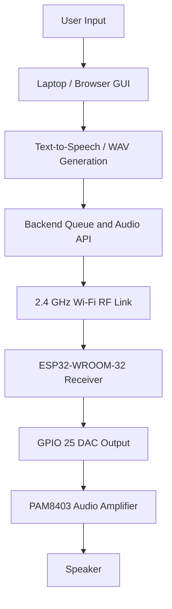

# Wireless Text-to-Speech Audio Transmission over Wi-Fi

**Live application:** https://esp32-tts-announcer.ai.studio  
**Hardware target:** ESP32-WROOM-32, 2.4 GHz Wi-Fi, PAM8403 amplifier and speaker.

A web-based announcement interface and ESP32 receiver prototype. Text is submitted to the backend, which attempts configured Wit.ai synthesis and otherwise creates a locally generated WAV signal. The ESP32 polls the backend over Wi-Fi, downloads the WAV file, and plays supported mono PCM audio through its built-in DAC.

> **Hardware validation status:** The standalone receiver sketch is now provided at [firmware/ESP32_Wireless_PA.ino](firmware/ESP32_Wireless_PA.ino). It has been statically reviewed against the repository's backend endpoints and WAV generator, but has not been compiled with the Arduino toolchain or verified on physical hardware in this repository. Do not treat dashboard demo values as measured experimental results.

## Block diagram



## How the system works

1. The user enters an announcement in the browser interface.
2. The backend validates the text and attempts Wit.ai synthesis when a server token is configured.
3. If that service is unavailable or not configured, the current backend generates a local WAV signal. This fallback is a synthetic tone/formant demonstration, **not intelligible text-to-speech**.
4. The backend stores the generated WAV in an in-memory cache and places the announcement in its queue.
5. The ESP32 joins the same reachable 2.4 GHz Wi-Fi network and polls `GET /api/esp32/poll`.
6. When a `STREAM` job is returned, the ESP32 downloads its `audioUrl` using HTTP.
7. The standalone sketch validates the WAV header and supports mono, 16-bit PCM, 8–48 kHz audio.
8. The ESP32 converts PCM samples to its 8-bit DAC output on GPIO 25. A PAM8403 amplifier drives the speaker.

## Modules

| Module | Function | Implementation |
|---|---|---|
| 1. User Interface & Text Acquisition | Enter announcement text | React + TypeScript browser interface |
| 2. Text Processing & Speech Synthesis | Generate audio from text | Express backend; optional Wit.ai; local synthetic WAV fallback |
| 3. Wireless Audio Streaming & Network Management | Queue polling and audio transfer | HTTP over 2.4 GHz Wi-Fi |
| 4. Embedded Playback & Monitoring | Decode WAV, play audio, report RSSI/status | ESP32 DAC firmware and backend report endpoint |

## Hardware and wiring

The standalone firmware targets **ESP32-WROOM-32 + PAM8403**. It does not use the MAX98357A I2S amplifier.

| ESP32 / supply | Connection |
|---|---|
| GPIO 25 (DAC1) | PAM8403 L_IN |
| GND | PAM8403 GND |
| Regulated 5 V supply | PAM8403 VCC |
| PAM8403 speaker output +L / -L | Speaker terminals |

Use a separate regulated supply for the amplifier if needed, with common ground. PAM8403 speaker outputs are bridge-tied: do not connect either speaker terminal to ground. Do not connect a speaker directly to an ESP32 GPIO. Confirm the exact breakout-board pin labels before wiring.

See [hardware/wiring-and-components.md](hardware/wiring-and-components.md).

## Repository structure

```text
.
├── src/                         # React + TypeScript web application
│   ├── components/              # UI, dashboard, device and EMF components
│   ├── data/
│   ├── services/
│   └── App.tsx
├── firmware/
│   └── ESP32_Wireless_PA.ino    # Standalone Wi-Fi/WAV/DAC receiver sketch
├── hardware/
│   └── wiring-and-components.md
├── docs/
│   ├── algorithm.md
│   ├── design-decisions.md
│   ├── system-architecture.md
│   ├── testing.md
│   └── contribution-and-ai-disclosure.md
├── media/
│   └── README.md
├── server.ts
└── README.md
```

## Software setup

### Backend and web application

Requirements: Node.js LTS and npm.

```bash
npm install
cp .env.example .env
npm run dev
```

Open the local URL printed by the development server. Add optional API credentials only to your local `.env` file or deployment secret manager. Never commit real tokens.

### ESP32 firmware

1. Install Arduino IDE.
2. Install the Espressif Systems ESP32 board package.
3. Install **ArduinoJson** (v6 or v7) from Library Manager.
4. Open `firmware/ESP32_Wireless_PA.ino`.
5. Set `WIFI_SSID`, `WIFI_PASSWORD` and `SERVER_BASE_URL` in the sketch.
6. Use the laptop/server's LAN IP address in `SERVER_BASE_URL`; do not use `localhost`.
7. Select the correct ESP32 board and port, upload, then open Serial Monitor at 115200 baud.

The laptop/server and ESP32 must be connected to the same network and the server port must be reachable through the laptop firewall.

## EMF & Waves relevance

The Wi-Fi link uses the 2.4 GHz ISM band. At 2.412 GHz:

`λ = c/f ≈ 3 × 10⁸ / 2.412 × 10⁹ ≈ 0.1244 m = 12.44 cm`

This project can be used to study RF propagation, antenna communication, attenuation, obstruction effects, RSSI and application latency. Record actual measurements from the ESP32 and test setup. The web dashboard includes demonstration/simulated values; these are not physical measurements.

## Testing

Follow [docs/testing.md](docs/testing.md). The checklist is intentionally unmarked until tests are performed. No physical range, latency, packet-loss or audio-quality result is claimed here.

## Known limitations

- The backend queue and audio cache are in-memory and are cleared when the server restarts.
- The local WAV fallback generates synthetic tones/formant-like audio, not spoken words.
- The external TTS provider's output must match the firmware's supported mono 16-bit PCM WAV format; other WAV encodings are rejected.
- The standalone firmware downloads each complete WAV into RAM before playback. Keep announcements short; large files may exceed available ESP32 heap.
- The firmware is a Wi-Fi/DAC/PAM8403 path. The Bluetooth A2DP code shown in the existing UI's Arduino tab is a separate prototype and is not part of this standalone sketch.
- Some dashboard RF readings, device states and progress indicators are demonstration/simulated values.

## Security

- Store Wit.ai and other API credentials only in environment variables or deployment secrets.
- Store Wi-Fi credentials locally in the sketch; do not commit them.
- Credentials previously committed to a public repository should be revoked/rotated. Removing them from the latest version does not erase earlier Git history.
- Do not expose control endpoints publicly without authentication and transport security.

## Contribution and AI disclosure

The project owner is responsible for the project concept, module selection, hardware assembly, wiring, configuration, physical experiments and interpretation of measured results. AI assistance was used for code drafting/review, debugging support, architecture explanations and documentation. See [docs/contribution-and-ai-disclosure.md](docs/contribution-and-ai-disclosure.md).

## License

No license is included because the owner has not selected one. The repository remains subject to default copyright rules until an appropriate license is deliberately added.
